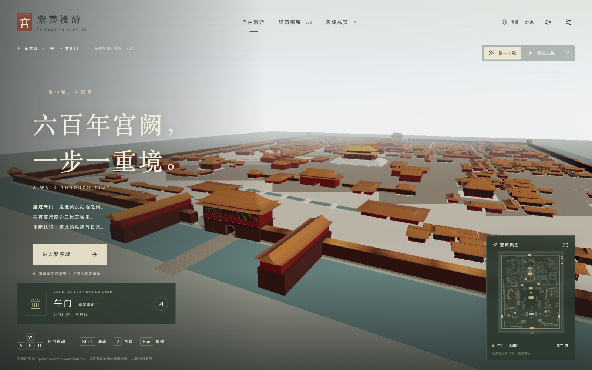
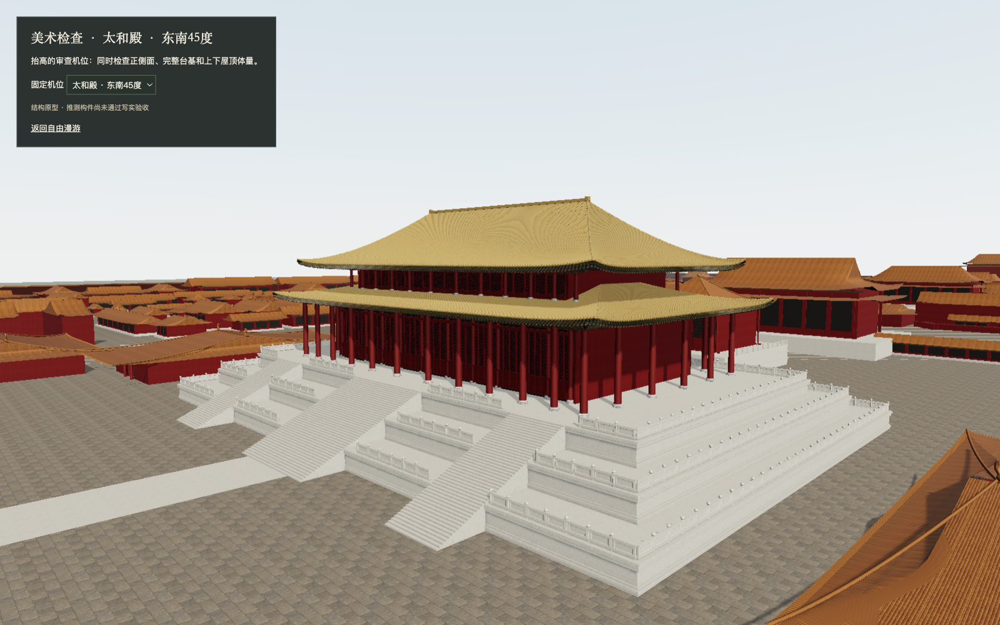
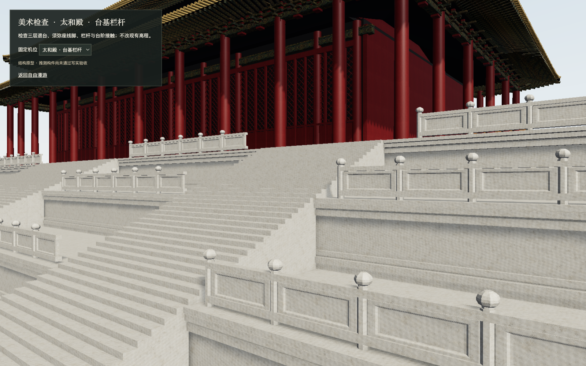

<div align="center">

# Forbidden City 3D · 紫禁漫游

**Walk through the courtyards, gates, and halls of Beijing’s Forbidden City in your browser.**

[English](README.md) · [简体中文](README.zh-CN.md)


[Quick start](#quick-start) · [Screenshots](#screenshots) · [Controls](#controls) · [Development](#development) · [Contributing](#contributing)

</div>



A desktop-first, real-time 3D exploration project built with React, Three.js, and React Three Fiber. Follow the central axis, switch between first- and third-person views, and explore architectural records alongside a map of the palace grounds.

> **Project scope:** v0.1.0 is a procedural architectural research prototype. Footprints have map references, but geometry, heights, and details include estimates. It is not a survey-grade digital twin or a finished photorealistic reconstruction. This is an independent project with no official affiliation with the Palace Museum. The application interface is currently in Chinese; this README is available in English and Chinese.

## Features

- **Explore on foot:** first-person mouse look, third-person follow camera, walking, running, and pause/resume.
- **Physical navigation:** a Rapier capsule character controller, gate passages, stairs, collision boundaries, and camera obstruction handling.
- **Find your way:** a minimap, expanded map, palace overview, and 10 teleport destinations along the central axis.
- **Read about buildings:** an architectural collection and nearby-building records with source and accuracy information.
- **Procedural architecture:** curved roofs, columns, bracket sets, lattice windows, terraces, and instanced components. The Hall of Supreme Harmony has a dedicated model with three terrace levels and geometric tile rows.
- **Adjust the experience:** three quality presets, morning/noon/evening lighting presets, and optional synthesized wind, birds, and footsteps. Sound is off by default.
- **Inspect the artwork:** 13 fixed review cameras, a six-material test scene, local PBR textures, HDRI lighting, and GTAO ambient occlusion.
- **Load local detail by region:** eight regions with asynchronous loading, retry, and resource release. Scene assets are served locally without runtime third-party asset APIs or API keys.

The dataset contains **841 map structure records**, including buildings, walls, platforms, and auxiliary footprints; **588 names remain unverified**. These counts do not represent 841 individually restored palaces.

## Screenshots

### Hall of Supreme Harmony · 太和殿



The current focal building: a dedicated column grid, double-eaved roof, tile rows, lattice doors, and stepped stone terraces.

### Terrace and stonework



Unretouched browser captures of the development build, taken on **October 20, 2026** at a **1600 × 1000** viewport. The hall images use the built-in art review cameras; they show the current prototype rather than final visual acceptance.

## Quick start

### Requirements

- **Node.js 22.12.0 or newer** and npm 10 or newer.
- A desktop browser with **WebGL 2**, a keyboard, and a mouse. Touch movement controls are not implemented.
- Network access to install dependencies. The core scene uses bundled local assets.

```sh
git clone https://github.com/ShenZiLi/forbidden-city-3d.git
cd forbidden-city-3d
npm ci
npm run dev
```

Open **http://127.0.0.1:5173/** and click **进入紫禁城** (Enter the Forbidden City). Allow the browser to lock the pointer for first-person mouse look.

The development server binds to localhost and uses a strict port. If port 5173 is occupied, stop the existing service before starting another instance.

### Build and preview

```sh
npm run build
npm run preview
```

The production build is written to `dist/`. The preview server normally opens at **http://127.0.0.1:4173/**. Serve `dist/` from the root of a static site. Deployment under a subdirectory also requires updating Vite’s `base` and the absolute local asset URLs in the manifests.

## Controls

| Action | Input |
| --- | --- |
| Start exploring | Click **进入紫禁城** |
| Move | **W / A / S / D** |
| Run | Hold **Shift** while moving |
| Look around | Move the mouse in first person; drag on the canvas in third person |
| Switch first/third person | **V** or the view toggle in the upper right |
| Pause / release the pointer | **Esc**; switching away from the browser also pauses exploration |
| Inspect a nearby building | **E** or the arrow on the building card |
| Teleport | **前往一处宫殿** (Choose a palace) or a destination on the expanded map |
| View the palace from above | **宫城总览** (Palace overview) in the top navigation |
| Open settings | The settings icon in the upper right |
| Toggle collision diagnostics | **F3** or the setting checkbox |

After pausing, click **继续漫游** (Resume). After teleporting, click the canvas to lock the pointer again. Changing perspective preserves the character’s position and heading.

## Technology

| Layer | Tools |
| --- | --- |
| Application | React 19, TypeScript 5.9, Vite 7 |
| 3D rendering | Three.js, React Three Fiber 9, Drei 10 |
| Physics | Rapier 3D, React Three Rapier 2 |
| Interface icons | Lucide React |
| Verification | Vitest, Playwright |
| Spatial data | OpenStreetMap footprints, a local WGS84-to-world coordinate transform |

## Development

### Commands

| Command | Purpose |
| --- | --- |
| `npm run dev` | Start the local development server |
| `npm run build` | Type-check and build the production application |
| `npm run preview` | Preview the production build locally |
| `npm test` | Run unit tests, including real Rapier WASM navigation checks |
| `npm run test:watch` | Run unit tests in watch mode |
| `npm run test:e2e` | Run the Playwright browser suite |
| `npm run validate` | Run unit tests followed by the production build |
| `node scripts/prepare-world.mjs` | Regenerate building and region data from the source snapshot |
| `node scripts/fetch-production-assets.mjs --verify` | Verify the nine production source assets offline |

For the standalone browser suite, install Chromium first:

```sh
npx playwright install chromium
npm run test:e2e
```

Playwright starts the local development server or reuses an existing one. Earlier Windows runs recorded a `spawn UNKNOWN` launch failure; connected-browser results are archived in [`docs/browser-results.json`](docs/browser-results.json). Those results do not establish that the standalone Playwright command passed in every environment. See [validation records](docs/VALIDATION.md) for historical context. A Windows/PowerShell Tabbit adapter is also available as `npm run test:browser:tabbit` and requires a running development server.

### Project structure

```text
src/
├── app/             Application state, startup, and development diagnostics
├── architecture/    Roofs, columns, bracket sets, stairs, walls, and materials
├── art/             Fixed review cameras and the material test scene
├── components/      HUD, maps, building records, settings, and loading UI
├── data/            Building schema, generated data, regions, and destinations
├── navigation/      Character controller, cameras, and collision rules
├── streaming/       Region loading and asset lifecycle management
├── tests/           Unit, geometry, data, and physics tests
└── world/           Coordinates, lighting, ground, gardens, and synthesized audio
public/
├── assets/          Local textures, materials, and environment maps
└── data/            OSM snapshot, attribution, and eight region datasets
tests/browser/       Browser interaction and performance checks
scripts/             Data generation, asset verification, and browser tooling
docs/                Sources, implementation notes, progress, and screenshots
```

### Spatial data and assets

**1 world unit = 1 meter.** X points east, Y points up, and **−Z points north**. The local WGS84 approximation is centered on latitude `39.9166`, longitude `116.39075`; this origin is not a surveyed control point. Do not mix GCJ-02 or BD-09 coordinates into the dataset without conversion.

The OSM snapshot is dated **October 19, 2026**. Update the source snapshot or explicit configuration in `scripts/prepare-world.mjs`, then regenerate and validate:

```sh
node scripts/prepare-world.mjs
npm run validate
```

The generated building database and region JSON files share IDs and geometry across rendering, maps, collision, interaction, and teleportation. Preserve source, accuracy, footprint, scale, entrance, and collision metadata when adding records.

For detailed models, place licensed, meter-scaled GLB files and textures under `public/assets/`, document their provenance, and integrate them through the building registry and region asset lifecycle. Keep simplified colliders separate from decorative meshes. GLB streaming and Draco, Meshopt, or KTX2 decoder integration are future work; current region streaming loads procedural detail configurations.

### Art review

With the development server running:

- **Hall review:** http://127.0.0.1:5173/?artReview=taihe-45 — use the selector to switch among 13 fixed cameras.
- **Material lab:** http://127.0.0.1:5173/?materialLab=1 — inspect six material samples with orbit controls.

`node scripts/fetch-production-assets.mjs` restores missing assets from the pinned source list. `--verify` is offline; `--refresh` explicitly re-queries provider metadata. See [production asset sources](docs/PRODUCTION_ASSET_SOURCES.md) before refreshing or replacing assets.

## Roadmap and current limits

- [x] First- and third-person exploration, physical navigation, maps, and building records.
- [x] Eight-region detail loading and 10 teleport destinations.
- [x] Initial dedicated Hall of Supreme Harmony model, local PBR/HDRI pipeline, and review tools.
- [ ] Survey-calibrated building positions, dimensions, and continuous terrace elevations.
- [ ] Historically accurate carvings, roof ornaments, decorative painting, and interiors.
- [ ] Consistent detailed courtyards and licensed high-detail assets across the palace grounds.
- [ ] Large-model streaming, long-session memory checks, and broader device/browser testing.
- [ ] Touch movement controls and more complete accessibility support.

Interiors are not reconstructed. Some elevated structures can only be approached externally, and the third-person character uses temporary procedural animation. Lighting presets are artistic, and synthesized audio is not field recording. Stable 60 FPS and full photorealism remain goals. See [known issues](docs/KNOWN_ISSUES.md) and [performance notes](docs/PERFORMANCE.md).

## Documentation

Most detailed production documents are currently in Chinese.

| Topic | Reference |
| --- | --- |
| Implementation and delivery status | [Implementation](docs/IMPLEMENTATION.md) · [Status](docs/STATUS.md) |
| Sources and asset provenance | [Sources](docs/SOURCES.md) · [Production assets](docs/PRODUCTION_ASSET_SOURCES.md) |
| Art direction and asset tracking | [Master plan](docs/ART_PRODUCTION_MASTERPLAN.md) · [Asset register](docs/ART_ASSET_REGISTER.md) · [Progress](docs/ART_PROGRESS.md) |
| Hall of Supreme Harmony references | [Reference packet](docs/TAIHE_REFERENCE_PACKET.md) · [Visual review](docs/ART_VISUAL_REVIEW.md) |
| Validation and remaining issues | [Validation](docs/VALIDATION.md) · [Performance](docs/PERFORMANCE.md) · [Known issues](docs/KNOWN_ISSUES.md) |

## Contributing

Bug reports, source corrections, performance investigations, and documented asset contributions are welcome.

1. [Open an issue](https://github.com/ShenZiLi/forbidden-city-3d/issues) for a bug or a substantial proposed change. For bugs, include reproduction steps, browser/OS, quality preset, and a screenshot when useful.
2. Fork the repository and create a focused branch.
3. Keep architectural claims traceable to sources. For models, textures, or audio, include the author, original URL, license, and any modifications in the source records.
4. Run `npm run validate`. Run browser checks when changing navigation or interface behavior, and compare fixed camera views when changing geometry or materials.
5. [Open a pull request](https://github.com/ShenZiLi/forbidden-city-3d/pulls) explaining the change and how it was checked.

## Credits and licensing

- **Map data:** © OpenStreetMap contributors. The OSM snapshot and OSM-derived database portions are provided under **ODbL 1.0**; see [data attribution and license](public/data/LICENSE.md).
- **PBR textures and HDRI:** selected Poly Haven assets under **CC0 1.0**, with authors and file-level provenance in [production asset sources](docs/PRODUCTION_ASSET_SOURCES.md). They are not samples taken at the Forbidden City.
- **Generated textures:** six AI-generated appearance textures are recorded in [`public/assets/textures/imperial-v2/manifest.json`](public/assets/textures/imperial-v2/manifest.json). They are artistic assets, not photographic scans.
- **Architectural references:** public Palace Museum information informs names and selected dimensions; this project is not an official museum product.
- **Dependencies:** retain their respective licenses. See the installed packages for full notices.

**Code license:** the repository currently has no root code `LICENSE` file. Public visibility does not itself grant an open-source code license. Data and third-party asset licenses apply to their respective materials separately.
